  

# Victor Alexandre

Construo automações, conecto sistemas e aplico IA para ampliar o que as pessoas conseguem fazer.

Graduando em Engenharia de Software com ênfase em IA. São Paulo, Brasil.

<!-- profile-projects:start -->
<h3></h3>

<a href="https://vitorcomc.com.br/projects/lios/"><picture><source media="(max-width: 767px)" srcset="assets/profile/lios-mobile.svg"></picture></a> <a href="https://vitorcomc.com.br/projects/eci/"><picture><source media="(max-width: 767px)" srcset="assets/profile/eci-mobile.svg"></picture></a>
 
<a href="https://vitorcomc.com.br/projects/ai-skills-library/"><picture><source media="(max-width: 767px)" srcset="assets/profile/ai-skills-library-mobile.svg"></picture></a> <a href="https://vitorcomc.com.br/projects/instagram-content-analyzer/"><picture><source media="(max-width: 767px)" srcset="assets/profile/instagram-content-analyzer-mobile.svg"></picture></a>
 
<a href="https://vitorcomc.com.br/projects/suno/"><picture><source media="(max-width: 767px)" srcset="assets/profile/suno-mobile.svg"></picture></a> <a href="https://vitorcomc.com.br/projects/automacoes-photoshop/"><picture><source media="(max-width: 767px)" srcset="assets/profile/automacoes-photoshop-mobile.svg"></picture></a>
 
<a href="https://vitorcomc.com.br/projects/focus-garden/"><picture><source media="(max-width: 767px)" srcset="assets/profile/focus-garden-mobile.svg"></picture></a> <a href="https://vitorcomc.com.br/projects/x-monitor/"><picture><source media="(max-width: 767px)" srcset="assets/profile/x-monitor-mobile.svg"></picture></a>
 
<a href="https://vitorcomc.com.br/projects/study-os/"><picture><source media="(max-width: 767px)" srcset="assets/profile/study-os-mobile.svg"></picture></a> <a href="https://vitorcomc.com.br/projects/n8n-infrastructure-migration/"><picture><source media="(max-width: 767px)" srcset="assets/profile/n8n-infrastructure-migration-mobile.svg"></picture></a>
 
<a href="https://vitorcomc.com.br/projects/astra/"><picture><source media="(max-width: 767px)" srcset="assets/profile/astra-mobile.svg"></picture></a> <a href="https://vitorcomc.com.br/projects/oei/"><picture><source media="(max-width: 767px)" srcset="assets/profile/oei-mobile.svg"></picture></a>
 
<a href="https://vitorcomc.com.br/projects/mafua/"><picture><source media="(max-width: 767px)" srcset="assets/profile/mafua-mobile.svg"></picture></a> <a href="https://vitorcomc.com.br/projects/notion-ai-hub/"><picture><source media="(max-width: 767px)" srcset="assets/profile/notion-ai-hub-mobile.svg"></picture></a>

<!-- profile-projects:end -->
