<picture>
  <source media="(prefers-color-scheme: dark)" srcset="assets/ascii-dark.svg">
  <source media="(prefers-color-scheme: light)" srcset="assets/ascii-light.svg">
  
</picture>

# Victor Alexandre

Construo automações, conecto sistemas e aplico IA para ampliar o que as pessoas conseguem fazer.

Graduando em Engenharia de Software com ênfase em IA. São Paulo, Brasil.

### Projetos

- [**LIOS**](https://vitorcomc.com.br/projects/lios/) — Produção e agendamento de posts para LinkedIn.
- [**ECI**](https://vitorcomc.com.br/projects/eci/) — Estratégia e conteúdo para Instagram com IA.
- [**AI Hub**](https://vitorcomc.com.br/projects/ai-skills-library/) — Biblioteca de agentes, skills e instruções de IA.
- [**Instagram Content Analyzer**](https://vitorcomc.com.br/projects/instagram-content-analyzer/) — Análise de Reels e carrosséis com registro no Notion.
- [**Suno Music Producer**](https://vitorcomc.com.br/projects/suno/) — Criação de músicas com IA, da letra ao áudio.
- [**Automações para Photoshop**](https://vitorcomc.com.br/projects/automacoes-photoshop/) — Scripts e plugin para layouts e carrosséis.
- [**Focus Garden**](https://vitorcomc.com.br/projects/focus-garden/) — App para macOS que transforma foco em um jardim.
- [**X Monitor**](https://vitorcomc.com.br/projects/x-monitor/) — Coleta e seleção de posts do X no Notion.
- [**Study OS**](https://vitorcomc.com.br/projects/study-os/) — Estudo com IA e revisão espaçada de flashcards.
- [**Migração do n8n**](https://vitorcomc.com.br/projects/n8n-infrastructure-migration/) — Migração do n8n para uma VPS menor.
- [**Astra**](https://vitorcomc.com.br/projects/astra/) — Jornada interativa por cinco estrelas reais.
- [**OEI**](https://vitorcomc.com.br/projects/oei/) — Protótipos para organizar e preparar aulas com IA.
- [**Mafuá**](https://vitorcomc.com.br/projects/mafua/) — Site WordPress convertido em arquivos estáticos.
- [**Workspace Notion**](https://vitorcomc.com.br/projects/notion-ai-hub/) — Gestão de projetos, tarefas e documentos no Notion.

[Portfólio ↗](https://vitorcomc.com.br/) · [LinkedIn ↗](https://www.linkedin.com/in/vitorcomc/) · [E-mail ↗](mailto:victoralexandrepk@gmail.com)
