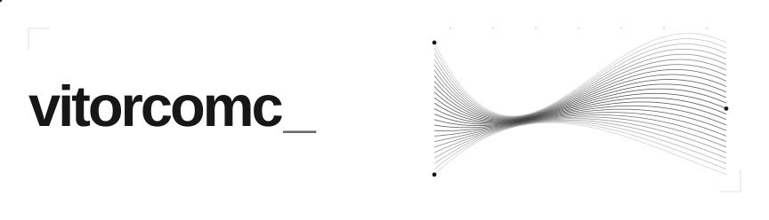

<picture>
  <source media="(prefers-color-scheme: dark)" srcset="assets/flow-dark.svg">
  <source media="(prefers-color-scheme: light)" srcset="assets/flow-light.svg">
  
</picture>

# Victor Alexandre

Construo automações, conecto sistemas e aplico IA para ampliar o que as pessoas conseguem fazer.

Graduando em Engenharia de Software com ênfase em IA. São Paulo, Brasil.

[Portfólio ↗](https://vitorcomc.com.br/) · [LinkedIn ↗](https://www.linkedin.com/in/vitorcomc/) · [E-mail ↗](mailto:victoralexandrepk@gmail.com)
