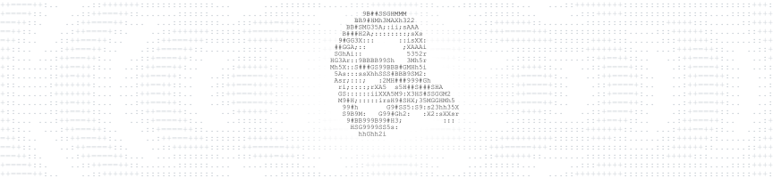

  <picture>
    <source media="(prefers-reduced-motion: reduce) and (prefers-color-scheme: dark)" srcset="assets/ascii-profile-dark-still.webp">
    <source media="(prefers-reduced-motion: reduce)" srcset="assets/ascii-profile-light-still.webp">
    <source media="(prefers-color-scheme: dark)" srcset="assets/ascii-profile-dark.webp">
    
  </picture>

# Victor Alexandre

Construo automações, conecto sistemas e aplico IA para ampliar o que as pessoas conseguem fazer.

Graduando em Engenharia de Software com ênfase em IA. São Paulo, Brasil.

<!-- profile-projects:start -->
<h3></h3>

<a href="https://vitorcomc.com.br/projects/lios/"><picture><source media="(max-width: 767px)" srcset="assets/profile/lios-mobile.svg 0.772947x"><source media="(max-width: 799px)" srcset="assets/profile/lios-mobile.svg 1.632653x"><source media="(max-width: 831px)" srcset="assets/profile/lios-mobile.svg 1.509434x"><source media="(max-width: 863px)" srcset="assets/profile/lios-mobile.svg 1.403509x"><source media="(max-width: 895px)" srcset="assets/profile/lios-mobile.svg 1.311475x"><source media="(max-width: 927px)" srcset="assets/profile/lios-mobile.svg 1.230769x"><source media="(max-width: 959px)" srcset="assets/profile/lios-mobile.svg 1.15942x"><source media="(max-width: 991px)" srcset="assets/profile/lios-mobile.svg 1.09589x"><source media="(max-width: 1023px)" srcset="assets/profile/lios-mobile.svg 1.038961x"><source media="(max-width: 1055px)" srcset="assets/profile/lios-compact.svg 1.458904x"><source media="(max-width: 1087px)" srcset="assets/profile/lios-compact.svg 1.383117x"><source media="(max-width: 1119px)" srcset="assets/profile/lios-compact.svg 1.314815x"><source media="(max-width: 1151px)" srcset="assets/profile/lios-compact.svg 1.252941x"><source media="(max-width: 1183px)" srcset="assets/profile/lios-compact.svg 1.196629x"><source media="(max-width: 1215px)" srcset="assets/profile/lios-compact.svg 1.145161x"><source media="(max-width: 1247px)" srcset="assets/profile/lios-compact.svg 1.097938x"><source media="(max-width: 1279px)" srcset="assets/profile/lios-compact.svg 1.054455x"><source srcset="assets/profile/lios.svg 1.028986x"></picture></a> <a href="https://vitorcomc.com.br/projects/eci/"><picture><source media="(max-width: 767px)" srcset="assets/profile/eci-mobile.svg 0.772947x"><source media="(max-width: 799px)" srcset="assets/profile/eci-mobile.svg 1.632653x"><source media="(max-width: 831px)" srcset="assets/profile/eci-mobile.svg 1.509434x"><source media="(max-width: 863px)" srcset="assets/profile/eci-mobile.svg 1.403509x"><source media="(max-width: 895px)" srcset="assets/profile/eci-mobile.svg 1.311475x"><source media="(max-width: 927px)" srcset="assets/profile/eci-mobile.svg 1.230769x"><source media="(max-width: 959px)" srcset="assets/profile/eci-mobile.svg 1.15942x"><source media="(max-width: 991px)" srcset="assets/profile/eci-mobile.svg 1.09589x"><source media="(max-width: 1023px)" srcset="assets/profile/eci-mobile.svg 1.038961x"><source media="(max-width: 1055px)" srcset="assets/profile/eci-compact.svg 1.458904x"><source media="(max-width: 1087px)" srcset="assets/profile/eci-compact.svg 1.383117x"><source media="(max-width: 1119px)" srcset="assets/profile/eci-compact.svg 1.314815x"><source media="(max-width: 1151px)" srcset="assets/profile/eci-compact.svg 1.252941x"><source media="(max-width: 1183px)" srcset="assets/profile/eci-compact.svg 1.196629x"><source media="(max-width: 1215px)" srcset="assets/profile/eci-compact.svg 1.145161x"><source media="(max-width: 1247px)" srcset="assets/profile/eci-compact.svg 1.097938x"><source media="(max-width: 1279px)" srcset="assets/profile/eci-compact.svg 1.054455x"><source srcset="assets/profile/eci.svg 1.028986x"></picture></a>
 
<a href="https://vitorcomc.com.br/projects/ai-skills-library/"><picture><source media="(max-width: 767px)" srcset="assets/profile/ai-skills-library-mobile.svg 0.772947x"><source media="(max-width: 799px)" srcset="assets/profile/ai-skills-library-mobile.svg 1.632653x"><source media="(max-width: 831px)" srcset="assets/profile/ai-skills-library-mobile.svg 1.509434x"><source media="(max-width: 863px)" srcset="assets/profile/ai-skills-library-mobile.svg 1.403509x"><source media="(max-width: 895px)" srcset="assets/profile/ai-skills-library-mobile.svg 1.311475x"><source media="(max-width: 927px)" srcset="assets/profile/ai-skills-library-mobile.svg 1.230769x"><source media="(max-width: 959px)" srcset="assets/profile/ai-skills-library-mobile.svg 1.15942x"><source media="(max-width: 991px)" srcset="assets/profile/ai-skills-library-mobile.svg 1.09589x"><source media="(max-width: 1023px)" srcset="assets/profile/ai-skills-library-mobile.svg 1.038961x"><source media="(max-width: 1055px)" srcset="assets/profile/ai-skills-library-compact.svg 1.458904x"><source media="(max-width: 1087px)" srcset="assets/profile/ai-skills-library-compact.svg 1.383117x"><source media="(max-width: 1119px)" srcset="assets/profile/ai-skills-library-compact.svg 1.314815x"><source media="(max-width: 1151px)" srcset="assets/profile/ai-skills-library-compact.svg 1.252941x"><source media="(max-width: 1183px)" srcset="assets/profile/ai-skills-library-compact.svg 1.196629x"><source media="(max-width: 1215px)" srcset="assets/profile/ai-skills-library-compact.svg 1.145161x"><source media="(max-width: 1247px)" srcset="assets/profile/ai-skills-library-compact.svg 1.097938x"><source media="(max-width: 1279px)" srcset="assets/profile/ai-skills-library-compact.svg 1.054455x"><source srcset="assets/profile/ai-skills-library.svg 1.028986x"></picture></a> <a href="https://vitorcomc.com.br/projects/instagram-content-analyzer/"><picture><source media="(max-width: 767px)" srcset="assets/profile/instagram-content-analyzer-mobile.svg 0.772947x"><source media="(max-width: 799px)" srcset="assets/profile/instagram-content-analyzer-mobile.svg 1.632653x"><source media="(max-width: 831px)" srcset="assets/profile/instagram-content-analyzer-mobile.svg 1.509434x"><source media="(max-width: 863px)" srcset="assets/profile/instagram-content-analyzer-mobile.svg 1.403509x"><source media="(max-width: 895px)" srcset="assets/profile/instagram-content-analyzer-mobile.svg 1.311475x"><source media="(max-width: 927px)" srcset="assets/profile/instagram-content-analyzer-mobile.svg 1.230769x"><source media="(max-width: 959px)" srcset="assets/profile/instagram-content-analyzer-mobile.svg 1.15942x"><source media="(max-width: 991px)" srcset="assets/profile/instagram-content-analyzer-mobile.svg 1.09589x"><source media="(max-width: 1023px)" srcset="assets/profile/instagram-content-analyzer-mobile.svg 1.038961x"><source media="(max-width: 1055px)" srcset="assets/profile/instagram-content-analyzer-compact.svg 1.458904x"><source media="(max-width: 1087px)" srcset="assets/profile/instagram-content-analyzer-compact.svg 1.383117x"><source media="(max-width: 1119px)" srcset="assets/profile/instagram-content-analyzer-compact.svg 1.314815x"><source media="(max-width: 1151px)" srcset="assets/profile/instagram-content-analyzer-compact.svg 1.252941x"><source media="(max-width: 1183px)" srcset="assets/profile/instagram-content-analyzer-compact.svg 1.196629x"><source media="(max-width: 1215px)" srcset="assets/profile/instagram-content-analyzer-compact.svg 1.145161x"><source media="(max-width: 1247px)" srcset="assets/profile/instagram-content-analyzer-compact.svg 1.097938x"><source media="(max-width: 1279px)" srcset="assets/profile/instagram-content-analyzer-compact.svg 1.054455x"><source srcset="assets/profile/instagram-content-analyzer.svg 1.028986x"></picture></a>
 
<a href="https://vitorcomc.com.br/projects/suno/"><picture><source media="(max-width: 767px)" srcset="assets/profile/suno-mobile.svg 0.772947x"><source media="(max-width: 799px)" srcset="assets/profile/suno-mobile.svg 1.632653x"><source media="(max-width: 831px)" srcset="assets/profile/suno-mobile.svg 1.509434x"><source media="(max-width: 863px)" srcset="assets/profile/suno-mobile.svg 1.403509x"><source media="(max-width: 895px)" srcset="assets/profile/suno-mobile.svg 1.311475x"><source media="(max-width: 927px)" srcset="assets/profile/suno-mobile.svg 1.230769x"><source media="(max-width: 959px)" srcset="assets/profile/suno-mobile.svg 1.15942x"><source media="(max-width: 991px)" srcset="assets/profile/suno-mobile.svg 1.09589x"><source media="(max-width: 1023px)" srcset="assets/profile/suno-mobile.svg 1.038961x"><source media="(max-width: 1055px)" srcset="assets/profile/suno-compact.svg 1.458904x"><source media="(max-width: 1087px)" srcset="assets/profile/suno-compact.svg 1.383117x"><source media="(max-width: 1119px)" srcset="assets/profile/suno-compact.svg 1.314815x"><source media="(max-width: 1151px)" srcset="assets/profile/suno-compact.svg 1.252941x"><source media="(max-width: 1183px)" srcset="assets/profile/suno-compact.svg 1.196629x"><source media="(max-width: 1215px)" srcset="assets/profile/suno-compact.svg 1.145161x"><source media="(max-width: 1247px)" srcset="assets/profile/suno-compact.svg 1.097938x"><source media="(max-width: 1279px)" srcset="assets/profile/suno-compact.svg 1.054455x"><source srcset="assets/profile/suno.svg 1.028986x"></picture></a> <a href="https://vitorcomc.com.br/projects/automacoes-photoshop/"><picture><source media="(max-width: 767px)" srcset="assets/profile/automacoes-photoshop-mobile.svg 0.772947x"><source media="(max-width: 799px)" srcset="assets/profile/automacoes-photoshop-mobile.svg 1.632653x"><source media="(max-width: 831px)" srcset="assets/profile/automacoes-photoshop-mobile.svg 1.509434x"><source media="(max-width: 863px)" srcset="assets/profile/automacoes-photoshop-mobile.svg 1.403509x"><source media="(max-width: 895px)" srcset="assets/profile/automacoes-photoshop-mobile.svg 1.311475x"><source media="(max-width: 927px)" srcset="assets/profile/automacoes-photoshop-mobile.svg 1.230769x"><source media="(max-width: 959px)" srcset="assets/profile/automacoes-photoshop-mobile.svg 1.15942x"><source media="(max-width: 991px)" srcset="assets/profile/automacoes-photoshop-mobile.svg 1.09589x"><source media="(max-width: 1023px)" srcset="assets/profile/automacoes-photoshop-mobile.svg 1.038961x"><source media="(max-width: 1055px)" srcset="assets/profile/automacoes-photoshop-compact.svg 1.458904x"><source media="(max-width: 1087px)" srcset="assets/profile/automacoes-photoshop-compact.svg 1.383117x"><source media="(max-width: 1119px)" srcset="assets/profile/automacoes-photoshop-compact.svg 1.314815x"><source media="(max-width: 1151px)" srcset="assets/profile/automacoes-photoshop-compact.svg 1.252941x"><source media="(max-width: 1183px)" srcset="assets/profile/automacoes-photoshop-compact.svg 1.196629x"><source media="(max-width: 1215px)" srcset="assets/profile/automacoes-photoshop-compact.svg 1.145161x"><source media="(max-width: 1247px)" srcset="assets/profile/automacoes-photoshop-compact.svg 1.097938x"><source media="(max-width: 1279px)" srcset="assets/profile/automacoes-photoshop-compact.svg 1.054455x"><source srcset="assets/profile/automacoes-photoshop.svg 1.028986x"></picture></a>
 
<a href="https://vitorcomc.com.br/projects/focus-garden/"><picture><source media="(max-width: 767px)" srcset="assets/profile/focus-garden-mobile.svg 0.772947x"><source media="(max-width: 799px)" srcset="assets/profile/focus-garden-mobile.svg 1.632653x"><source media="(max-width: 831px)" srcset="assets/profile/focus-garden-mobile.svg 1.509434x"><source media="(max-width: 863px)" srcset="assets/profile/focus-garden-mobile.svg 1.403509x"><source media="(max-width: 895px)" srcset="assets/profile/focus-garden-mobile.svg 1.311475x"><source media="(max-width: 927px)" srcset="assets/profile/focus-garden-mobile.svg 1.230769x"><source media="(max-width: 959px)" srcset="assets/profile/focus-garden-mobile.svg 1.15942x"><source media="(max-width: 991px)" srcset="assets/profile/focus-garden-mobile.svg 1.09589x"><source media="(max-width: 1023px)" srcset="assets/profile/focus-garden-mobile.svg 1.038961x"><source media="(max-width: 1055px)" srcset="assets/profile/focus-garden-compact.svg 1.458904x"><source media="(max-width: 1087px)" srcset="assets/profile/focus-garden-compact.svg 1.383117x"><source media="(max-width: 1119px)" srcset="assets/profile/focus-garden-compact.svg 1.314815x"><source media="(max-width: 1151px)" srcset="assets/profile/focus-garden-compact.svg 1.252941x"><source media="(max-width: 1183px)" srcset="assets/profile/focus-garden-compact.svg 1.196629x"><source media="(max-width: 1215px)" srcset="assets/profile/focus-garden-compact.svg 1.145161x"><source media="(max-width: 1247px)" srcset="assets/profile/focus-garden-compact.svg 1.097938x"><source media="(max-width: 1279px)" srcset="assets/profile/focus-garden-compact.svg 1.054455x"><source srcset="assets/profile/focus-garden.svg 1.028986x"></picture></a> <a href="https://vitorcomc.com.br/projects/x-monitor/"><picture><source media="(max-width: 767px)" srcset="assets/profile/x-monitor-mobile.svg 0.772947x"><source media="(max-width: 799px)" srcset="assets/profile/x-monitor-mobile.svg 1.632653x"><source media="(max-width: 831px)" srcset="assets/profile/x-monitor-mobile.svg 1.509434x"><source media="(max-width: 863px)" srcset="assets/profile/x-monitor-mobile.svg 1.403509x"><source media="(max-width: 895px)" srcset="assets/profile/x-monitor-mobile.svg 1.311475x"><source media="(max-width: 927px)" srcset="assets/profile/x-monitor-mobile.svg 1.230769x"><source media="(max-width: 959px)" srcset="assets/profile/x-monitor-mobile.svg 1.15942x"><source media="(max-width: 991px)" srcset="assets/profile/x-monitor-mobile.svg 1.09589x"><source media="(max-width: 1023px)" srcset="assets/profile/x-monitor-mobile.svg 1.038961x"><source media="(max-width: 1055px)" srcset="assets/profile/x-monitor-compact.svg 1.458904x"><source media="(max-width: 1087px)" srcset="assets/profile/x-monitor-compact.svg 1.383117x"><source media="(max-width: 1119px)" srcset="assets/profile/x-monitor-compact.svg 1.314815x"><source media="(max-width: 1151px)" srcset="assets/profile/x-monitor-compact.svg 1.252941x"><source media="(max-width: 1183px)" srcset="assets/profile/x-monitor-compact.svg 1.196629x"><source media="(max-width: 1215px)" srcset="assets/profile/x-monitor-compact.svg 1.145161x"><source media="(max-width: 1247px)" srcset="assets/profile/x-monitor-compact.svg 1.097938x"><source media="(max-width: 1279px)" srcset="assets/profile/x-monitor-compact.svg 1.054455x"><source srcset="assets/profile/x-monitor.svg 1.028986x"></picture></a>
 
<a href="https://vitorcomc.com.br/projects/study-os/"><picture><source media="(max-width: 767px)" srcset="assets/profile/study-os-mobile.svg 0.772947x"><source media="(max-width: 799px)" srcset="assets/profile/study-os-mobile.svg 1.632653x"><source media="(max-width: 831px)" srcset="assets/profile/study-os-mobile.svg 1.509434x"><source media="(max-width: 863px)" srcset="assets/profile/study-os-mobile.svg 1.403509x"><source media="(max-width: 895px)" srcset="assets/profile/study-os-mobile.svg 1.311475x"><source media="(max-width: 927px)" srcset="assets/profile/study-os-mobile.svg 1.230769x"><source media="(max-width: 959px)" srcset="assets/profile/study-os-mobile.svg 1.15942x"><source media="(max-width: 991px)" srcset="assets/profile/study-os-mobile.svg 1.09589x"><source media="(max-width: 1023px)" srcset="assets/profile/study-os-mobile.svg 1.038961x"><source media="(max-width: 1055px)" srcset="assets/profile/study-os-compact.svg 1.458904x"><source media="(max-width: 1087px)" srcset="assets/profile/study-os-compact.svg 1.383117x"><source media="(max-width: 1119px)" srcset="assets/profile/study-os-compact.svg 1.314815x"><source media="(max-width: 1151px)" srcset="assets/profile/study-os-compact.svg 1.252941x"><source media="(max-width: 1183px)" srcset="assets/profile/study-os-compact.svg 1.196629x"><source media="(max-width: 1215px)" srcset="assets/profile/study-os-compact.svg 1.145161x"><source media="(max-width: 1247px)" srcset="assets/profile/study-os-compact.svg 1.097938x"><source media="(max-width: 1279px)" srcset="assets/profile/study-os-compact.svg 1.054455x"><source srcset="assets/profile/study-os.svg 1.028986x"></picture></a> <a href="https://vitorcomc.com.br/projects/n8n-infrastructure-migration/"><picture><source media="(max-width: 767px)" srcset="assets/profile/n8n-infrastructure-migration-mobile.svg 0.772947x"><source media="(max-width: 799px)" srcset="assets/profile/n8n-infrastructure-migration-mobile.svg 1.632653x"><source media="(max-width: 831px)" srcset="assets/profile/n8n-infrastructure-migration-mobile.svg 1.509434x"><source media="(max-width: 863px)" srcset="assets/profile/n8n-infrastructure-migration-mobile.svg 1.403509x"><source media="(max-width: 895px)" srcset="assets/profile/n8n-infrastructure-migration-mobile.svg 1.311475x"><source media="(max-width: 927px)" srcset="assets/profile/n8n-infrastructure-migration-mobile.svg 1.230769x"><source media="(max-width: 959px)" srcset="assets/profile/n8n-infrastructure-migration-mobile.svg 1.15942x"><source media="(max-width: 991px)" srcset="assets/profile/n8n-infrastructure-migration-mobile.svg 1.09589x"><source media="(max-width: 1023px)" srcset="assets/profile/n8n-infrastructure-migration-mobile.svg 1.038961x"><source media="(max-width: 1055px)" srcset="assets/profile/n8n-infrastructure-migration-compact.svg 1.458904x"><source media="(max-width: 1087px)" srcset="assets/profile/n8n-infrastructure-migration-compact.svg 1.383117x"><source media="(max-width: 1119px)" srcset="assets/profile/n8n-infrastructure-migration-compact.svg 1.314815x"><source media="(max-width: 1151px)" srcset="assets/profile/n8n-infrastructure-migration-compact.svg 1.252941x"><source media="(max-width: 1183px)" srcset="assets/profile/n8n-infrastructure-migration-compact.svg 1.196629x"><source media="(max-width: 1215px)" srcset="assets/profile/n8n-infrastructure-migration-compact.svg 1.145161x"><source media="(max-width: 1247px)" srcset="assets/profile/n8n-infrastructure-migration-compact.svg 1.097938x"><source media="(max-width: 1279px)" srcset="assets/profile/n8n-infrastructure-migration-compact.svg 1.054455x"><source srcset="assets/profile/n8n-infrastructure-migration.svg 1.028986x"></picture></a>
 
<a href="https://vitorcomc.com.br/projects/astra/"><picture><source media="(max-width: 767px)" srcset="assets/profile/astra-mobile.svg 0.772947x"><source media="(max-width: 799px)" srcset="assets/profile/astra-mobile.svg 1.632653x"><source media="(max-width: 831px)" srcset="assets/profile/astra-mobile.svg 1.509434x"><source media="(max-width: 863px)" srcset="assets/profile/astra-mobile.svg 1.403509x"><source media="(max-width: 895px)" srcset="assets/profile/astra-mobile.svg 1.311475x"><source media="(max-width: 927px)" srcset="assets/profile/astra-mobile.svg 1.230769x"><source media="(max-width: 959px)" srcset="assets/profile/astra-mobile.svg 1.15942x"><source media="(max-width: 991px)" srcset="assets/profile/astra-mobile.svg 1.09589x"><source media="(max-width: 1023px)" srcset="assets/profile/astra-mobile.svg 1.038961x"><source media="(max-width: 1055px)" srcset="assets/profile/astra-compact.svg 1.458904x"><source media="(max-width: 1087px)" srcset="assets/profile/astra-compact.svg 1.383117x"><source media="(max-width: 1119px)" srcset="assets/profile/astra-compact.svg 1.314815x"><source media="(max-width: 1151px)" srcset="assets/profile/astra-compact.svg 1.252941x"><source media="(max-width: 1183px)" srcset="assets/profile/astra-compact.svg 1.196629x"><source media="(max-width: 1215px)" srcset="assets/profile/astra-compact.svg 1.145161x"><source media="(max-width: 1247px)" srcset="assets/profile/astra-compact.svg 1.097938x"><source media="(max-width: 1279px)" srcset="assets/profile/astra-compact.svg 1.054455x"><source srcset="assets/profile/astra.svg 1.028986x"></picture></a> <a href="https://vitorcomc.com.br/projects/oei/"><picture><source media="(max-width: 767px)" srcset="assets/profile/oei-mobile.svg 0.772947x"><source media="(max-width: 799px)" srcset="assets/profile/oei-mobile.svg 1.632653x"><source media="(max-width: 831px)" srcset="assets/profile/oei-mobile.svg 1.509434x"><source media="(max-width: 863px)" srcset="assets/profile/oei-mobile.svg 1.403509x"><source media="(max-width: 895px)" srcset="assets/profile/oei-mobile.svg 1.311475x"><source media="(max-width: 927px)" srcset="assets/profile/oei-mobile.svg 1.230769x"><source media="(max-width: 959px)" srcset="assets/profile/oei-mobile.svg 1.15942x"><source media="(max-width: 991px)" srcset="assets/profile/oei-mobile.svg 1.09589x"><source media="(max-width: 1023px)" srcset="assets/profile/oei-mobile.svg 1.038961x"><source media="(max-width: 1055px)" srcset="assets/profile/oei-compact.svg 1.458904x"><source media="(max-width: 1087px)" srcset="assets/profile/oei-compact.svg 1.383117x"><source media="(max-width: 1119px)" srcset="assets/profile/oei-compact.svg 1.314815x"><source media="(max-width: 1151px)" srcset="assets/profile/oei-compact.svg 1.252941x"><source media="(max-width: 1183px)" srcset="assets/profile/oei-compact.svg 1.196629x"><source media="(max-width: 1215px)" srcset="assets/profile/oei-compact.svg 1.145161x"><source media="(max-width: 1247px)" srcset="assets/profile/oei-compact.svg 1.097938x"><source media="(max-width: 1279px)" srcset="assets/profile/oei-compact.svg 1.054455x"><source srcset="assets/profile/oei.svg 1.028986x"></picture></a>
 
<a href="https://vitorcomc.com.br/projects/mafua/"><picture><source media="(max-width: 767px)" srcset="assets/profile/mafua-mobile.svg 0.772947x"><source media="(max-width: 799px)" srcset="assets/profile/mafua-mobile.svg 1.632653x"><source media="(max-width: 831px)" srcset="assets/profile/mafua-mobile.svg 1.509434x"><source media="(max-width: 863px)" srcset="assets/profile/mafua-mobile.svg 1.403509x"><source media="(max-width: 895px)" srcset="assets/profile/mafua-mobile.svg 1.311475x"><source media="(max-width: 927px)" srcset="assets/profile/mafua-mobile.svg 1.230769x"><source media="(max-width: 959px)" srcset="assets/profile/mafua-mobile.svg 1.15942x"><source media="(max-width: 991px)" srcset="assets/profile/mafua-mobile.svg 1.09589x"><source media="(max-width: 1023px)" srcset="assets/profile/mafua-mobile.svg 1.038961x"><source media="(max-width: 1055px)" srcset="assets/profile/mafua-compact.svg 1.458904x"><source media="(max-width: 1087px)" srcset="assets/profile/mafua-compact.svg 1.383117x"><source media="(max-width: 1119px)" srcset="assets/profile/mafua-compact.svg 1.314815x"><source media="(max-width: 1151px)" srcset="assets/profile/mafua-compact.svg 1.252941x"><source media="(max-width: 1183px)" srcset="assets/profile/mafua-compact.svg 1.196629x"><source media="(max-width: 1215px)" srcset="assets/profile/mafua-compact.svg 1.145161x"><source media="(max-width: 1247px)" srcset="assets/profile/mafua-compact.svg 1.097938x"><source media="(max-width: 1279px)" srcset="assets/profile/mafua-compact.svg 1.054455x"><source srcset="assets/profile/mafua.svg 1.028986x"></picture></a> <a href="https://vitorcomc.com.br/projects/notion-ai-hub/"><picture><source media="(max-width: 767px)" srcset="assets/profile/notion-ai-hub-mobile.svg 0.772947x"><source media="(max-width: 799px)" srcset="assets/profile/notion-ai-hub-mobile.svg 1.632653x"><source media="(max-width: 831px)" srcset="assets/profile/notion-ai-hub-mobile.svg 1.509434x"><source media="(max-width: 863px)" srcset="assets/profile/notion-ai-hub-mobile.svg 1.403509x"><source media="(max-width: 895px)" srcset="assets/profile/notion-ai-hub-mobile.svg 1.311475x"><source media="(max-width: 927px)" srcset="assets/profile/notion-ai-hub-mobile.svg 1.230769x"><source media="(max-width: 959px)" srcset="assets/profile/notion-ai-hub-mobile.svg 1.15942x"><source media="(max-width: 991px)" srcset="assets/profile/notion-ai-hub-mobile.svg 1.09589x"><source media="(max-width: 1023px)" srcset="assets/profile/notion-ai-hub-mobile.svg 1.038961x"><source media="(max-width: 1055px)" srcset="assets/profile/notion-ai-hub-compact.svg 1.458904x"><source media="(max-width: 1087px)" srcset="assets/profile/notion-ai-hub-compact.svg 1.383117x"><source media="(max-width: 1119px)" srcset="assets/profile/notion-ai-hub-compact.svg 1.314815x"><source media="(max-width: 1151px)" srcset="assets/profile/notion-ai-hub-compact.svg 1.252941x"><source media="(max-width: 1183px)" srcset="assets/profile/notion-ai-hub-compact.svg 1.196629x"><source media="(max-width: 1215px)" srcset="assets/profile/notion-ai-hub-compact.svg 1.145161x"><source media="(max-width: 1247px)" srcset="assets/profile/notion-ai-hub-compact.svg 1.097938x"><source media="(max-width: 1279px)" srcset="assets/profile/notion-ai-hub-compact.svg 1.054455x"><source srcset="assets/profile/notion-ai-hub.svg 1.028986x"></picture></a>

<a href="https://vitorcomc.com.br/"><picture><source media="(max-width: 767px)" srcset="assets/profile/contact-portfolio.svg 0.681159x"><source media="(max-width: 799px)" srcset="assets/profile/contact-portfolio.svg 2.186047x"><source media="(max-width: 831px)" srcset="assets/profile/contact-portfolio.svg 2.014286x"><source media="(max-width: 863px)" srcset="assets/profile/contact-portfolio.svg 1.88x"><source media="(max-width: 895px)" srcset="assets/profile/contact-portfolio.svg 1.751553x"><source media="(max-width: 927px)" srcset="assets/profile/contact-portfolio.svg 1.639535x"><source media="(max-width: 959px)" srcset="assets/profile/contact-portfolio.svg 1.549451x"><source media="(max-width: 991px)" srcset="assets/profile/contact-portfolio.svg 1.46114x"><source media="(max-width: 1023px)" srcset="assets/profile/contact-portfolio.svg 1.382353x"><source media="(max-width: 1055px)" srcset="assets/profile/contact-portfolio.svg 1.46114x"><source media="(max-width: 1087px)" srcset="assets/profile/contact-portfolio.svg 1.382353x"><source media="(max-width: 1119px)" srcset="assets/profile/contact-portfolio.svg 1.317757x"><source media="(max-width: 1151px)" srcset="assets/profile/contact-portfolio.svg 1.253333x"><source media="(max-width: 1183px)" srcset="assets/profile/contact-portfolio.svg 1.194915x"><source media="(max-width: 1215px)" srcset="assets/profile/contact-portfolio.svg 1.146341x"><source media="(max-width: 1247px)" srcset="assets/profile/contact-portfolio.svg 1.097276x"><source media="(max-width: 1279px)" srcset="assets/profile/contact-portfolio.svg 1.052239x"><source srcset="assets/profile/contact-portfolio.svg 1.029197x"></picture></a>
<a href="https://www.linkedin.com/in/vitorcomc/"><picture><source media="(max-width: 767px)" srcset="assets/profile/contact-linkedin.svg 0.681159x"><source media="(max-width: 799px)" srcset="assets/profile/contact-linkedin.svg 2.186047x"><source media="(max-width: 831px)" srcset="assets/profile/contact-linkedin.svg 2.014286x"><source media="(max-width: 863px)" srcset="assets/profile/contact-linkedin.svg 1.88x"><source media="(max-width: 895px)" srcset="assets/profile/contact-linkedin.svg 1.751553x"><source media="(max-width: 927px)" srcset="assets/profile/contact-linkedin.svg 1.639535x"><source media="(max-width: 959px)" srcset="assets/profile/contact-linkedin.svg 1.549451x"><source media="(max-width: 991px)" srcset="assets/profile/contact-linkedin.svg 1.46114x"><source media="(max-width: 1023px)" srcset="assets/profile/contact-linkedin.svg 1.382353x"><source media="(max-width: 1055px)" srcset="assets/profile/contact-linkedin.svg 1.46114x"><source media="(max-width: 1087px)" srcset="assets/profile/contact-linkedin.svg 1.382353x"><source media="(max-width: 1119px)" srcset="assets/profile/contact-linkedin.svg 1.317757x"><source media="(max-width: 1151px)" srcset="assets/profile/contact-linkedin.svg 1.253333x"><source media="(max-width: 1183px)" srcset="assets/profile/contact-linkedin.svg 1.194915x"><source media="(max-width: 1215px)" srcset="assets/profile/contact-linkedin.svg 1.146341x"><source media="(max-width: 1247px)" srcset="assets/profile/contact-linkedin.svg 1.097276x"><source media="(max-width: 1279px)" srcset="assets/profile/contact-linkedin.svg 1.052239x"><source srcset="assets/profile/contact-linkedin.svg 1.029197x"></picture></a>
<a href="mailto:victoralexandrepk@gmail.com"><picture><source media="(max-width: 767px)" srcset="assets/profile/contact-email.svg 0.681159x"><source media="(max-width: 799px)" srcset="assets/profile/contact-email.svg 2.186047x"><source media="(max-width: 831px)" srcset="assets/profile/contact-email.svg 2.014286x"><source media="(max-width: 863px)" srcset="assets/profile/contact-email.svg 1.88x"><source media="(max-width: 895px)" srcset="assets/profile/contact-email.svg 1.751553x"><source media="(max-width: 927px)" srcset="assets/profile/contact-email.svg 1.639535x"><source media="(max-width: 959px)" srcset="assets/profile/contact-email.svg 1.549451x"><source media="(max-width: 991px)" srcset="assets/profile/contact-email.svg 1.46114x"><source media="(max-width: 1023px)" srcset="assets/profile/contact-email.svg 1.382353x"><source media="(max-width: 1055px)" srcset="assets/profile/contact-email.svg 1.46114x"><source media="(max-width: 1087px)" srcset="assets/profile/contact-email.svg 1.382353x"><source media="(max-width: 1119px)" srcset="assets/profile/contact-email.svg 1.317757x"><source media="(max-width: 1151px)" srcset="assets/profile/contact-email.svg 1.253333x"><source media="(max-width: 1183px)" srcset="assets/profile/contact-email.svg 1.194915x"><source media="(max-width: 1215px)" srcset="assets/profile/contact-email.svg 1.146341x"><source media="(max-width: 1247px)" srcset="assets/profile/contact-email.svg 1.097276x"><source media="(max-width: 1279px)" srcset="assets/profile/contact-email.svg 1.052239x"><source srcset="assets/profile/contact-email.svg 1.029197x"></picture></a>

<!-- profile-projects:end -->
